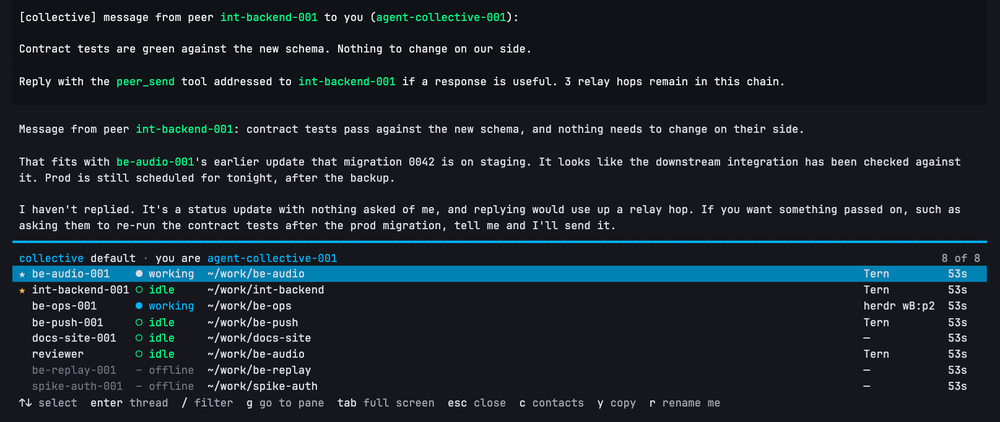
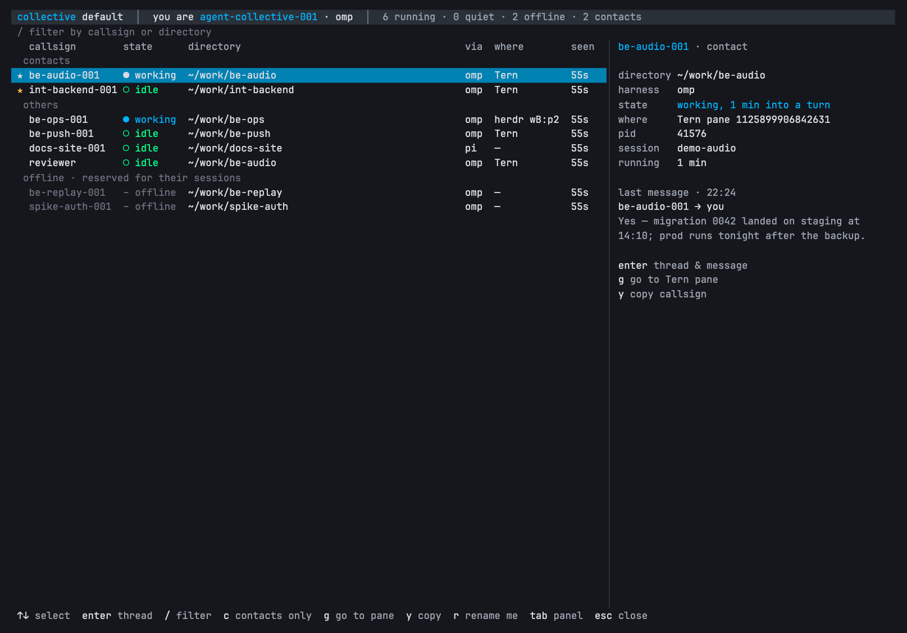
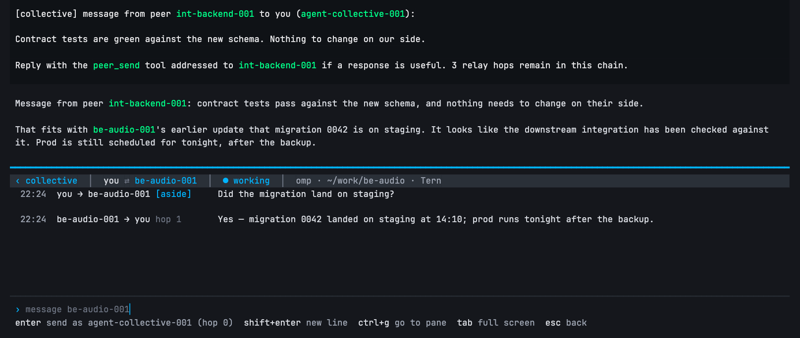

# agent-collective

Peer messaging between [omp](https://www.npmjs.com/package/@oh-my-pi/pi-coding-agent) and
[pi](https://www.npmjs.com/package/@earendil-works/pi-coding-agent) sessions on one machine.

Ask one session to talk to another — "ask @be-audio whether the migration landed" — and it does:

```
peers filter="audio"               → find the exact callsign
peer_send to="be-audio" message="…" → a real prompt in that session; its reply arrives here
```



Three rules:

- **Scoped by omp profile.** Sessions started with `omp --profile greenely` form their own
  collective; they never see sessions in the default profile, and vice versa. pi has no profiles,
  so pi sessions join `default`.
- **Silent.** Starting or closing a session notifies nobody. Nothing is added to prompts. A session
  finds out who is online only when it asks (`peers`, `/collective`).
- **Need-to-know.** A session's contacts are the peers it has messaged or heard from. Only those show
  in its footer chip, and they are remembered per session across resume.

## Install

omp:

```sh
omp plugin install agent-collective
omp --profile <name> plugin install agent-collective   # once per extra profile
```

pi:

```sh
pi install npm:agent-collective
```

Restart each session you want reachable (extensions load at session start).

This repo also ships `.omp-plugin/marketplace.json`, so it works as an omp marketplace source:

```sh
omp plugin marketplace add andreiverdes/agent-collective
omp plugin install agent-collective@agent-collective
```

Install it **one way only**. Two copies loaded in one process means two nodes per session: two
records and two sockets.

## Use

| Input                         | Effect                                                                     |
| ----------------------------- | -------------------------------------------------------------------------- |
| `/rename 007`                 | Renames the session; the collective adopts `007` as the callsign           |
| `/callsign 007`               | Sets the callsign only, leaving the session title alone                    |
| `/collective`                 | Opens the collective TUI (below); a plain list on hosts without a TUI      |
| `peers` (tool)                | Same list for the agent, optional `filter`; contacts first                 |
| `peer_send` (tool)            | Prompt a session by callsign (`@name` accepted); the reply arrives as a peer message |

An idle peer wakes into a turn. A busy omp peer receives the message as an aside, which does not
interrupt its running tool batch; a busy pi peer is steered (pi has no aside).

### The /collective TUI

A panel along the bottom of the screen, over the editor, with the transcript still visible above
it (omp and pi): one row per session, up to 8, scrolling beyond that. `tab` switches to full
screen, which adds sections and a detail column, and back; the choice sticks for the next
`/collective` in that process. It reads the collective from disk every 2 s; opening it costs no
model turn.

`tab` gives the full-screen list, with contacts, others and offline callsigns in sections, and a
detail column for the selected session:



`enter` opens the thread with that peer: every message both ways, each sent one tagged with what
happened to it (`aside` here: the peer was mid-turn), and a composer:



The screenshots are of a real omp session in a demo collective (its peers are the test harness's
fake sessions).

| Key | Sessions list | Thread with one peer |
| --- | --- | --- |
| `↑↓` / `j k`, PgUp/PgDn | select | |
| `enter` | open the thread | send the message |
| `shift+enter` / `alt+enter` | | new line |
| `/` | filter by callsign or directory | |
| `c` | contacts only | |
| `g` / `ctrl+g` | focus the session's Tern or herdr pane | focus its pane |
| `y` | copy the callsign | |
| `r` | rename this session (`ctrl+u` in the dialog clears a `/callsign` override) | |
| `tab` | full screen ⇄ bottom panel | full screen ⇄ bottom panel |
| `esc` | clear the filter, then close | back to the list (the draft is kept) |

Contacts come first, then the other running sessions, then offline callsigns (dimmed). A message
typed in the TUI goes out as this session at hop 0: you typed it, so it starts a new chain. It
does not enter this session's conversation, so when the peer next messages back, the message
arrives with what you sent it quoted ahead of it; otherwise your agent would see an answer with
no question.

### CLI

```sh
agent-collective list   [--profile P] [--json]
agent-collective send   [--profile P] [--from LABEL] <callsign> <message…>
agent-collective thread [--profile P] --session <id> [--peer <callsign>] [--json]
```

Runs under node ≥ 22 or bun. `send` delivers as a person, not a session: the peer is told the
message came from the user and to answer in its own pane. Exit codes: 0 delivered, 2 unknown or
offline callsign, 1 any other failure.

### Tern

[`tern/`](tern/README.md) is a Tern plugin: a **Collective** pane beside your agent panes, with the
same list, a thread view, a composer that sends through the CLI, and **Go to pane**. Install it with
`tern plugin install github.com/andreiverdes/agent-collective/tern`.

### Callsigns

Unnamed sessions are numbered by directory: the first unnamed session in `be-audio/` is
`be-audio-001`, the next `be-audio-002`, and so on, using the lowest number not held or reserved.

A callsign belongs to its **session**, not its process. When a session exits (or crashes, or you
switch away from it with `/resume`, `/new` or `/fork`), its callsign stays reserved for that
session id for 7 days after it last ran: nobody else is given it, a message to it is answered
"offline" instead of reaching someone else, and resuming the session — in a new process or with
`/resume` — takes it back. A reservation unused for 7 days expires and the number becomes free
again. So in `be-audio`: start 001, 002, 003; close 002; the next new session is 004, and resuming
the closed one makes it 002 again.

Name a session to choose its callsign: `/rename be-audio` (saved as the session title) or
`/callsign be-audio` (callsign only, remembered for that session). If a live session already holds
the name, the newcomer becomes `be-audio-002` and is told so; the first holder keeps the plain
name.

A session name is adopted only when the host reports the title as user-set (`/rename`, RPC). A
callsign is an address, and an auto-generated title is a model-written sentence that
`title.refreshOnReplan` rewrites mid-session — adopting it would rename a session and break every
peer's addressing. pi exposes no title source, so there a session name is adopted only when it
already looks like an address: one token, no whitespace, within the length cap. A `/rename` is
picked up within 5 s.

No two sessions in a collective ever share a callsign: each one is a claim file under `names/`,
created with an exclusive open, so of any number of sessions starting at once exactly one gets each
name. A running session refreshes its claim about once a minute; the claim's age is what a
reservation expires from. A claim is treated as running only while its pid exists with the same
process start time, so a reused pid does not keep it. Renaming a session away from a callsign frees
that callsign immediately; it is not reserved.

## How it works

- Each process writes `~/.agent-collective/<profile>/<pid>.json` (0600) and listens on `<pid>.sock`
  beside it. The record is written at start, on rename, and when a turn starts or ends — there is
  no heartbeat loop, and no process reads anyone else's record until a tool asks.
- A record is removed only when its process is gone (`kill(pid, 0)`). A live process's files are
  never touched by anyone else, however old its record: a laptop sleep or a stalled event loop is
  not death.
- Every 5 s each process `stat`s its own socket. If the file is missing or is not the one it bound,
  it binds a fresh temporary path and renames it into place. A sender that hits a missing or
  refusing socket on a live peer waits up to 7 s for it to re-appear and retries once.
- Per-session state (callsign, `/callsign` override, contacts) lives in
  `~/.agent-collective/<profile>/sessions/<session-id>.json`, and the session's last 500 messages
  (time, peer, direction, hop, outcome, text) in `sessions/<session-id>.log.jsonl`.
- A record carries where the session's terminal is: `TERN_PANE`, herdr's `HERDR_PANE_ID`, or the
  tty. That is all *go to pane* needs.

## Limits

- **Same machine only.** Unix sockets, one directory per profile. For remote pairing use omp's
  `/collab`.
- **0.3.x and 0.4 sessions cannot see each other.** 0.4 moved records into per-profile directories;
  restart every session after upgrading.
- **A suspended peer cannot answer.** Sends to a `SIGSTOP`ped or sleeping process fail after the
  7 s wait; `peers` marks a record not updated for 5+ minutes as possibly suspended.
- **Chains stop at 4 hops.** Every message carries its distance from the human prompt that started
  the chain; past the limit, delivery is refused with an explicit error telling the sender the chain
  ends there, and a local warning is shown. A message that wakes an idle agent sets the hop for
  everything that turn sends; one that steers into a running turn only affects replies to its
  sender. A human prompt or the end of the turn resets the count. This exists because mutual wake
  is a *behavioural* loop — A wakes B, B's turn wakes A — where each delivery is a legitimate
  single hop, so no transport-level guard trips. Raise or lower `MAX_HOPS` in `index.ts` if 4 is
  wrong for you.
- **Bursts become one wake.** Messages from one peer arriving within 400 ms are delivered as a single
  numbered batch, so N messages cost one turn rather than N.

## Development

```sh
npm test   # spawns real processes on real sockets under a temp HOME (~30 s)
```

## License

MIT
